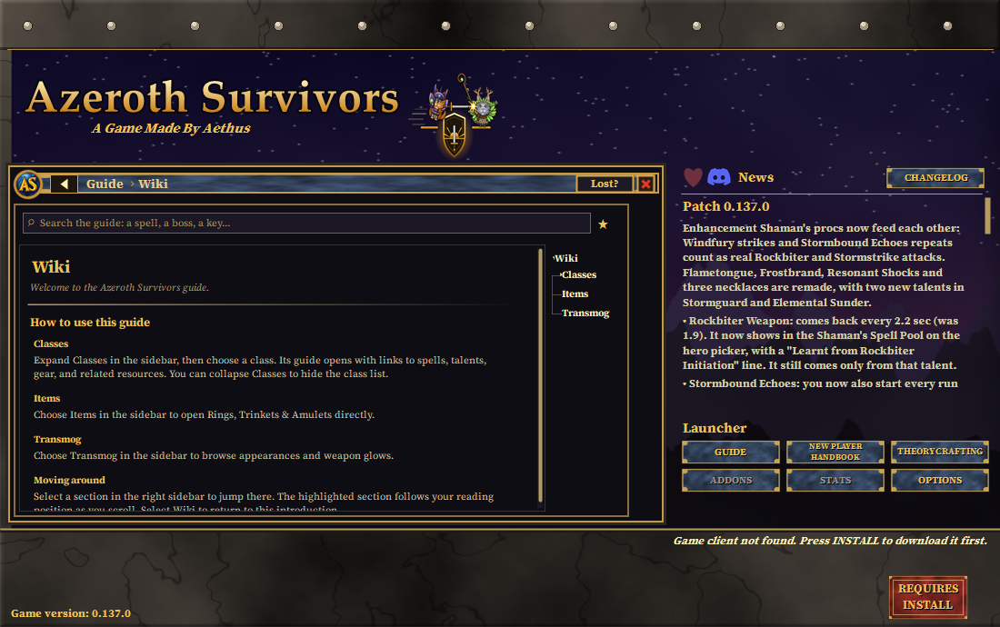
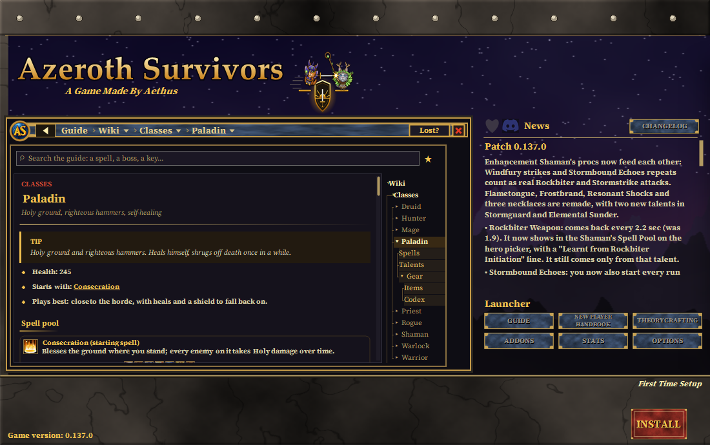
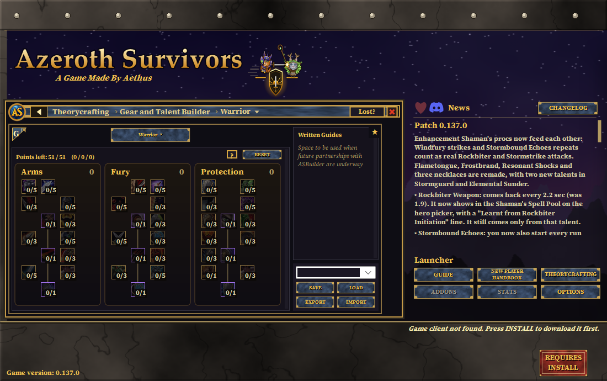
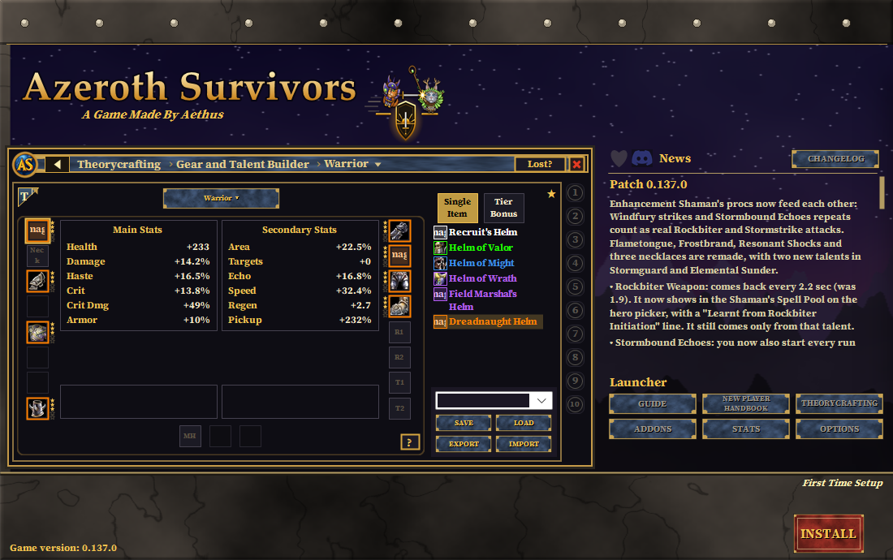
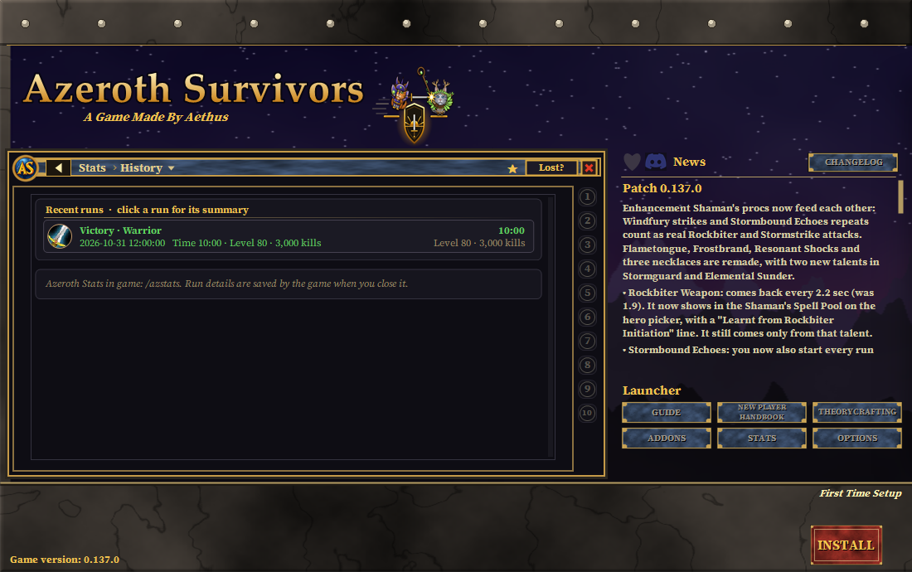
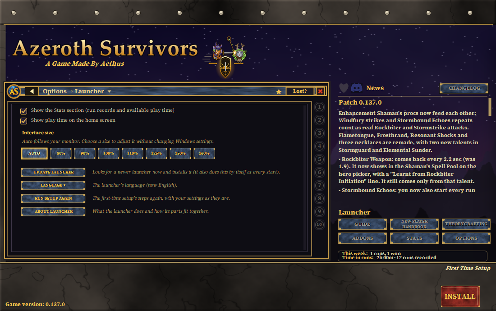

# Azeroth Survivors Launcher

A community-made Windows launcher by **Slimjim** for [Azeroth Survivors](https://wow.aethus.pl/), the game created by **Aethus**.

Install the game, manage addons, read the guide, and plan your next build—all from one place.

**Official Verified Launcher:** This launcher was officially verified when launchers were allowed on October 28, 2026. In the days that followed, I prepared it for launch and plan to release it as soon as possible.

**[Download the launcher](https://github.com/Slimmy25/Azeroth-Survivors-Launcher/releases/latest)**

Download `Azeroth Survivors Launcher.exe` and put it beside your game, or in the folder where you want to install it. First-time setup walks you through the rest. Requires Windows with .NET Framework 4.8.

## Project partners and foundations

These projects deserve a place up front:

- **[ASBuilder](https://github.com/cadoky/ASBuilder)** by **Cadoky** — the talent and gear build-sharing project behind our work on compatible import/export codes for [ASBuilds](https://asbuilds.app/).
- **[Azeroth Stats](https://github.com/Maidenquinn/AzerothStats)** by **Maidenhead** — the in-game run and build tracker supporting our work on launcher statistics.
- **[ASDataSync](https://github.com/KeijinDE/ASDataSync)** by **Keijin** — the original cloud-save sync framework that this launcher's cloud saving is built on, used with his blessing.
- **[SurvivorsForge](https://forge.rezondes.net/) ([project repository](https://github.com/Rezondes/SurvivorsForge))** — The game owner has approved the launcher’s addon manager. Community members manually review addon code and releases; the launcher records those decisions in its own catalog. SurvivorsForge supplies addon pictures when a matching listing has them. The launcher keeps its own addon catalog and download sources.

## Inside the launcher

- **Install and play:** guided setup, game downloads, updates, and a built-in ZIP/7z/RAR extractor. The extractor is bundled in the launcher, so game installation does not require a separate archive program.
- **Addons:** browse community addons, check individual updates or Update All, and review source-specific update errors. A diagonal badge flags confirmed updates. See [how addon updates work](docs/addon-updates.md).
  - **Download More** shows available SurvivorsForge pictures and the launcher’s static Verified marks; it does not download addons from SurvivorsForge.
  - AZSSpellMeter and AZS Max Hit are alternatives; Azeroth Cursor, Big Cursor and Cursor Reticle are mutually exclusive.
  - **Slim Suite** (`/azsmods`) provides UI movement, sizing, scaling and gameplay helpers. Its settings are grouped into “Modifying the User Interface” and “New/Unique, but Minor Features.”
- **Guide:** beginner help, class guides, items, and links between related topics.
- **Theorycrafting:** explore talent trees and compare gear and set bonuses.
- **Display:** resize the window while preserving its proportions, or maximize it in a centered, ratio-fitted size. Adjust interface size under Options > Launcher without changing Windows scaling.
- **Saves:** import/export game saves and optionally sync through your own cloud folder.
- **Community:** videos, creator guides, and the developer's patch notes.

## Screenshots

These screenshots were captured from the local WinForms preview with sample data. The display renderer simulates some display contexts; the images are not a physical mixed-monitor test.

| Wiki | Class guide | Talent builder |
| --- | --- | --- |
|  |  |  |

| Gear planner | Statistics | Launcher settings |
| --- | --- | --- |
|  |  |  |

## More information

- [Launcher guide, features, and build instructions](docs/launcher-guide.md)
- [Full credits, artwork sources, and licenses](CREDITS.md)
- [Report an issue](https://github.com/Slimmy25/Azeroth-Survivors-Launcher/issues)

The game is made by Aethus. This launcher is a separate community project and downloads the game from its download hosts. It is not affiliated with or endorsed by Blizzard Entertainment.

Launcher announcements use a timestamped whisper box with Slimjim’s avatar. [Adding a post](docs/launcher-announcements.md).
